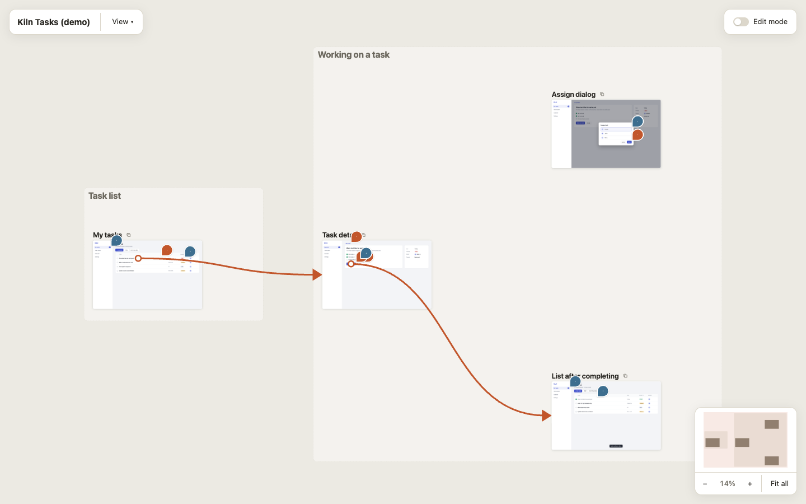
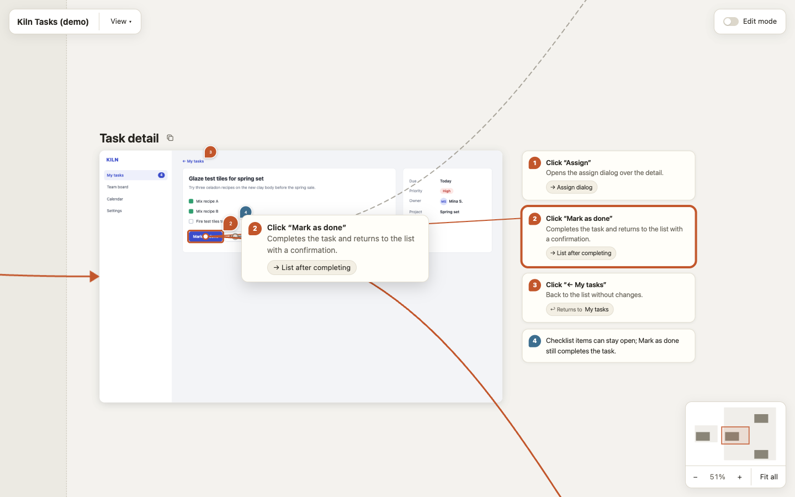
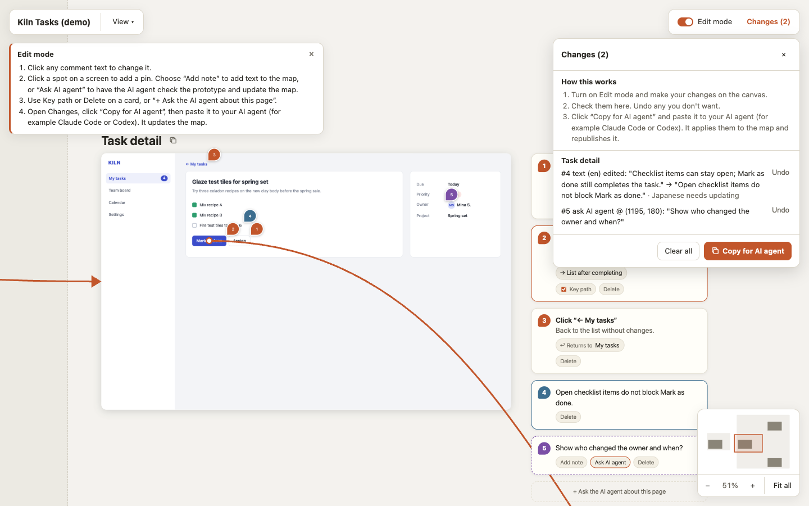

# frontend-to-flow

An agent skill that turns a running frontend or prototype into a bilingual (English / Japanese) **flow map**: a pannable canvas of real screen captures, key-path arrows between them, and numbered comments pinned to the controls they describe. The result is one self-contained HTML file that opens in any browser.

Readers can switch on **Edit mode** in the page to edit comments, change key paths, drop new pins or ask the AI agent to check something, then **Copy for AI agent** and paste the result to their agent, which applies it and re-renders the map.



| Comments pinned to controls | Edit mode and the change list |
| --- | --- |
|  |  |

The screenshots use **Kiln Tasks**, a fictional app included in [`examples/kiln-tasks`](examples/kiln-tasks). Open [`kiln-flow.html`](examples/kiln-tasks/kiln-flow.html) after cloning to try the map yourself.

## Works with any agent

The skill is plain files: `SKILL.md` with instructions, an HTML template and two Python scripts (standard library only). Any coding agent that reads `SKILL.md` skills, can drive a browser (for example with Playwright) and can run Python can use it. Claude Code and Codex are examples; nothing in the map depends on a particular agent.

## Install

Clone it into the skills folder your agent reads. For Claude Code:

```bash
git clone https://github.com/charlie5188/frontend-to-flow.git ~/.claude/skills/frontend-to-flow
```

For other agents, clone it into that agent's skills folder, or point the agent at `SKILL.md` directly. Then ask the agent to make a flow map of your prototype.

## Use without an agent

You can also write `flow-spec.json` and the captures yourself and render the map by hand:

```bash
python3 scripts/render_flow.py examples/kiln-tasks/bundle --out my-flow.html
```

See [SKILL.md](SKILL.md) for the procedure, the `flow-spec.json` format and how a pasted change list is applied.

## Contents

- `SKILL.md`: instructions for the agent.
- `assets/flow-map.html`: the page template (canvas, comments, edit mode, both languages).
- `scripts/render_flow.py`: validates a bundle and renders one offline HTML file.
- `scripts/to_artifact.py`: optional; converts a rendered map into a claude.ai Artifact page.
- `examples/kiln-tasks/`: the fictional demo app, its captures and spec, and the rendered map.
- `docs/`: the preview images above.

Inspired by frontend-to-ue (BadbotAI/BadGoods). The renderer and template here are written from scratch.
